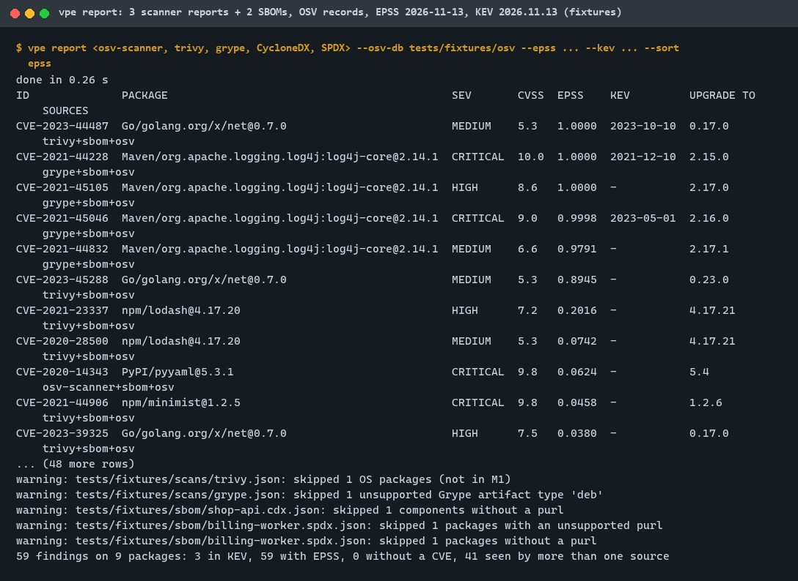
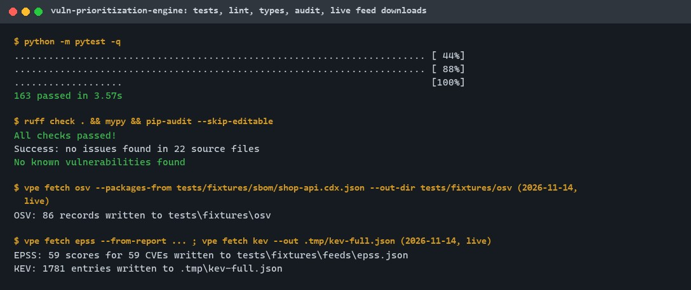
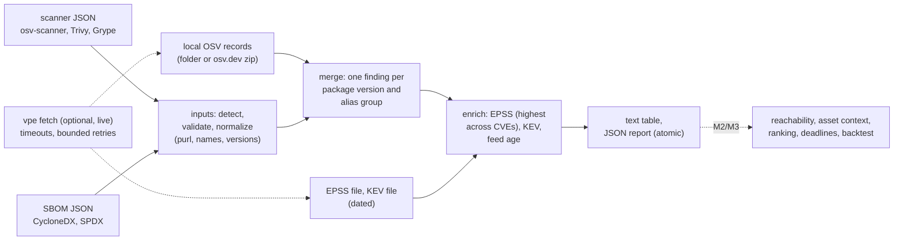
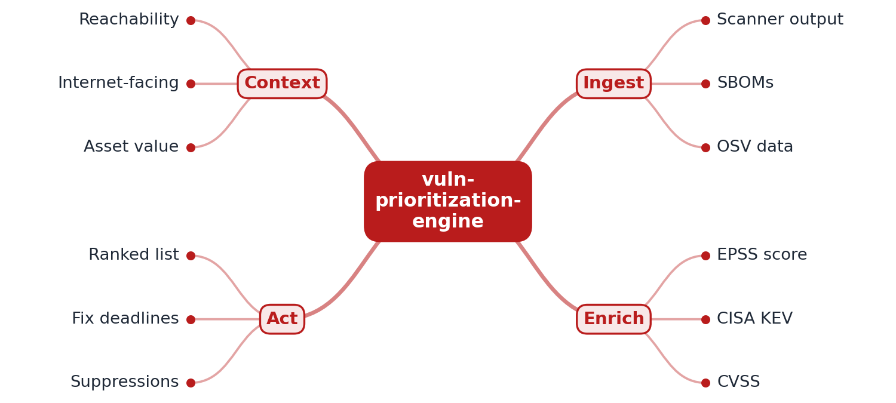

# vuln-prioritization-engine

[](https://github.com/EquinoxWN/vuln-prioritization-engine/actions/workflows/ci.yml)


> Scanners report 800 CVEs and teams fix none: rank vulnerabilities by real risk (exploitation, reachability, exposure) so the right ten get fixed first.

Part of my **Cyber Security** list · Python · core project

## Proof it works

`vpe report` reads three scanner reports (osv-scanner, Trivy, Grype) and two SBOMs (CycloneDX,
SPDX) for a fictional service, matches the SBOM packages against 86 OSV records, and adds EPSS
scores (2026-11-13) and CISA KEV status (catalog 2026.11.13). The five inputs overlap heavily and
use different ids for the same bugs; the result is 59 findings, exactly as many as the SBOM alone
gives, 41 of them confirmed by more than one source, 3 in KEV. Sorted by EPSS here; ranking is M3:



163 tests pass with no network; lint, strict types and the dependency audit are clean. The fixtures
were downloaded with the tool's own `vpe fetch` commands on 2026-11-14:



## Architecture

**What M1 runs today:**



**Full roadmap (M1 to M3):**



## How it works

_Steps 1 and 2 are built and tested (M1); the rest is on the [roadmap](#roadmap)._

1. Scanner results and SBOMs are normalized, with vulnerability details from the OSV database.
2. Each finding is enriched with its EPSS exploitation probability and whether it's in CISA's Known Exploited Vulnerabilities list.
3. Reachability analysis checks whether the vulnerable function is actually called by the code.
4. Asset context (internet-facing, handles personal data) raises or lowers priority.
5. A ranked list assigns fix deadlines; suppressions need a reason and an expiry.
6. Backtesting on historical CVEs measures how many later-exploited bugs were ranked near the top.

What M1 does with each input:

| Input | Read from | Notes |
|---|---|---|
| osv-scanner JSON | `results[].packages[]` with embedded OSV records | the record's ids, aliases, CVSS and fixed versions |
| Trivy JSON (schema 2) | `Results[].Vulnerabilities[]` | `PkgIdentifier.PURL` or the result `Type`; `VendorIDs` as aliases; OS-package results skipped and counted |
| Grype JSON | `matches[]` | `relatedVulnerabilities` as aliases; artifact purl or type; OS packages skipped and counted |
| CycloneDX JSON | `components[]`, nested ones included | each purl is matched against the OSV database |
| SPDX 2.x JSON | `packages[].externalRefs` of type `purl` | same |
| OSV database | folder of OSV JSON records or an osv.dev `all.zip` | `versions` lists, SEMVER and ECOSYSTEM ranges (OSV spec algorithm) for PyPI (PEP 440), npm, Go, crates.io (SemVer) and Maven (simplified order); GIT ranges ignored; withdrawn records skipped |
| EPSS | FIRST API JSON or the daily CSV (`.gz` too) | highest score across the finding's CVE aliases |
| KEV | CISA catalog JSON | `count` must match the entries, so a truncated download fails |

Each finding has a display id (lowest CVE, else GHSA), every alias, the package and purl, summary,
CVSS v3 vector and base score (computed, v3.0 and v3.1), severity, fixed versions, the lowest
fixed version above the installed one (`upgrade_to`), sources, locations, where its details came
from, EPSS, KEV, and notes (for example "no CVE alias" or a scanner/OSV disagreement). Exit codes:
0 ok, 2 bad input, 3 download failed.

## Who it helps

- **Who:** application security and platform engineers who collect output from several scanners and SBOM tools across services, and the developers who receive the resulting list.
- **The problem:** the same bug arrives as a CVE from one tool, a GHSA from another and a GO or PYSEC id from OSV, with different severities; without exploitation data every "critical" looks equally urgent.
- **How to use it:** point `vpe report` at your scanner JSON and SBOMs, a local OSV database and dated EPSS and KEV files; you get one deduplicated list (text and JSON) where each finding shows its CVSS score, EPSS probability, KEV date and the version to upgrade to. Refresh the data with `vpe fetch` on your own schedule; the report warns when a feed is older than `--max-feed-age` days.

## Tech stack

| Area | In M1 | Planned |
|---|---|---|
| Core | Python 3.11+, `packaging` (PEP 440); SemVer, Maven and CVSS v3 written here | CVSS v4 scoring |
| Inputs | osv-scanner, Trivy and Grype JSON; CycloneDX and SPDX JSON SBOMs; OSV records (folder or zip) | OS packages (Debian, RPM, Alpine) |
| Signals | FIRST EPSS (API JSON or daily CSV), CISA KEV catalog, CVSS from OSV records | Code reachability, asset context (M2) |
| Output | Text table, JSON report written atomically, exit codes | Ranked fix list, deadlines, suppressions, SARIF (M3) |
| Data refresh | `vpe fetch kev/epss/osv`: HTTPS, timeouts, bounded retries, size cap; a CI job runs it (not yet run) | Scheduled snapshots for the backtest (M3) |

Language: **Python** (3.11+). Code in [`src/vuln_prioritization_engine/`](src/vuln_prioritization_engine): input readers (`inputs.py`), package URLs (`purl.py`), version ordering (`versions.py`), OSV database and range matching (`osvdb.py`), CVSS (`cvss.py`), feeds (`feeds.py`), merging and enrichment (`engine.py`), reports (`report.py`), downloads (`fetch.py`) and the CLI (`cli.py`).

## Run it

**Prerequisites:** Python 3.11+. No environment variables are read by the tool; downloads honour
the standard `HTTPS_PROXY` and `NO_PROXY` variables through Python's `urllib`. The tool never runs
a scanner and never scans a host: it reads files that scanners or SBOM tools produced.

```bash
python -m venv .venv && source .venv/bin/activate   # Windows: .venv\Scripts\activate
make setup     # install the package and dev tools
make lint      # ruff, ruff format, mypy --strict
make test      # 163 tests, no network
make demo      # report on the shipped fixtures
make audit     # pip-audit
```

Report on your own files:

```bash
vpe report trivy.json grype.json sbom.cdx.json \
  --osv-db osv/ --epss epss.json --kev kev.json \
  --sort epss --json report.json --max-feed-age 7
```

Fetch fresh data (optional, needs network; each request has a timeout and bounded retries):

```bash
vpe fetch kev  --out data/kev.json
vpe fetch osv  --packages-from sbom.cdx.json --out-dir data/osv      # or --id GHSA-...
vpe fetch epss --from-report report.json --out data/epss.json        # or --cve CVE-...
```

The OSV database can also be an osv.dev ecosystem dump such as
`https://osv-vulnerabilities.storage.googleapis.com/PyPI/all.zip`, passed as `--osv-db PyPI-all.zip`.

## Tests and results

Full numbers and commands: [docs/results/m1.md](docs/results/m1.md). The 10-rule quality check (failure paths, retry safety, mutation testing) is in [docs/quality/2026-11-01.md](docs/quality/2026-11-01.md). Fixture sources and dates: [tests/fixtures/SOURCES.md](tests/fixtures/SOURCES.md).

| Check | Result |
|---|---|
| Tests (`make test`) | **163 passed** locally, 0 failed, 0 skipped, no network |
| Offline OSV matching vs the OSV API | identical ids on 10 of 10 packages (86 ids) |
| Merging | 5 overlapping inputs give 59 findings, the same as the SBOM alone; 0 duplicates |
| Enrichment | 59 of 59 findings with EPSS, 3 in KEV (CVE-2021-44228, CVE-2021-45046, CVE-2023-44487) |
| CVSS | 11 of 11 test vectors equal the published base scores |
| Mutation testing | 16 of 16 hand mutants killed (12 on the first run; 4 tests added) |
| Lint / audit | ruff, mypy `--strict` clean; `pip-audit`: no known vulnerabilities |

| Test file | Tests | What it proves |
|---|---|---|
| `test_cvss_versions.py` | 38 | CVSS v3 base scores and severity boundaries; SemVer, PEP 440 and Maven ordering; invalid vectors and versions rejected |
| `test_osvdb.py` | 30 | OSV range algorithm (including 300 random ranges against a brute-force model), record validation, aliases, withdrawn and zip databases, agreement with the OSV API on every package |
| `test_inputs.py` | 29 | the five input formats, purl parsing, skipped OS packages, malformed, oversized and escape-carrying input rejected |
| `test_feeds.py` | 28 | EPSS JSON, CSV and gzip; KEV catalog; every validation failure, including a truncated KEV |
| `test_engine.py` | 17 | merging by alias groups, OSV details first, idempotence, EPSS/KEV enrichment, feed-age warnings, upgrade target |
| `test_fetch.py` | 8 | fake-opener download client: timeouts passed, bounded retries with backoff, no retry on 404, size cap, https only, atomic validated writes, bounded OSV pagination |
| `test_cli.py` | 13 | `vpe report` end to end with exact counts, atomic JSON rewrite, sort orders, bad input exits 2 |

## Roadmap

**M1** (≈15 h)
- [x] Write `docs/rfc/0001-design.md`: problem, goals, non-goals, chosen design
- [x] Scanner results and SBOMs are normalized, with vulnerability details from the OSV database.
- [x] Each finding is enriched with its EPSS exploitation probability and whether it's in CISA's Known Exploited Vulnerabilities list.

**M2** (≈20 h)
- [ ] Reachability analysis checks whether the vulnerable function is actually called by the code.
- [ ] Asset context (internet-facing, handles personal data) raises or lowers priority.

**M3** (≈25 h)
- [ ] A ranked list assigns fix deadlines; suppressions need a reason and an expiry.
- [ ] Backtesting on historical CVEs measures how many later-exploited bugs were ranked near the top.
- [ ] Publish the proof below with real numbers

## Proof

What this repo must show before it counts as done:

- Backtest: share of later-exploited CVEs ranked in the top 10%, compared with CVSS-only ranking.

| Result | Value |
|---|---|
| M3 backtest above | Not measured yet (M3). Current M1 numbers: see [Tests and results](#tests-and-results). |

## Why it matters

- **Interview angle:** 'We have thousands of vulnerabilities: where do we start?' vulnerability-management questions.
- **Upstream I'd like to contribute to:** OSV and osv-scanner (Google): docs or tests.

## Design docs

- [RFC 0001: design](docs/rfc/0001-design.md)
- [ADR 0001: record architecture decisions](docs/adr/0001-record-architecture-decisions.md)
- [ADR 0002: local OSV database and dated feed files; live downloads are optional](docs/adr/0002-local-osv-database-and-dated-feed-snapshots.md)
- [ADR 0003: merge by alias groups; OSV details win](docs/adr/0003-merge-by-alias-groups-osv-details-win.md)
- [M1 results](docs/results/m1.md)
- [Quality check (10 rules)](docs/quality/2026-11-01.md)

## Scope

This is a learning and portfolio system, not a hosted production service. It reads scanner output
and SBOMs; it never scans a host or a network. The shipped scanner reports were built from real
OSV records in each scanner's documented JSON layout, not produced by running the scanners. Known
limits: OS packages are skipped; RubyGems, NuGet and Packagist match only through enumerated
versions; the Maven order is simplified; CVSS v4 vectors are kept but not scored; the KEV fixture
is an 8-entry subset of the catalog.

## Security and contributing

- Every GitHub Action is pinned to a commit SHA; workflows run read-only, without persisted credentials.
- Dependabot update pull requests are paused (`open-pull-requests-limit: 0`) so the repository keeps a single `main` branch; dependencies are updated by hand and checked by the CI audit.
- `vpe report` makes no network call. `vpe fetch` uses HTTPS only, a timeout per attempt, at most 5 retries with backoff and a 32 MiB cap, and validates data before an atomic write. Inputs are size-capped and validated; ids that become file names cannot contain path separators.
- Report vulnerabilities privately: see [SECURITY.md](SECURITY.md). To contribute, see [CONTRIBUTING.md](CONTRIBUTING.md).

## License

MIT, see [LICENSE](LICENSE).
